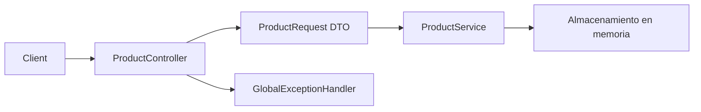

# Ejercicio 002 — API de productos con validaciones

**Nivel:** Principiante–intermedio · **Tiempo estimado:** 6–9 horas

## Contexto y enunciado

Una tienda solicita una API para registrar y consultar productos. Los datos incompletos o inválidos deben rechazarse con una respuesta uniforme que ayude al cliente a corregir su solicitud.

## Objetivos y conocimientos previos

Aprender DTO, Bean Validation, `@Valid`, códigos HTTP y manejo global de excepciones. Requiere completar el ejercicio 001 y entender clases, JSON y colecciones. La persistencia todavía no es necesaria.

## Requisitos

### Funcionales

1. Crear, listar, consultar por ID y actualizar productos.
2. Aceptar nombre, descripción opcional, precio y cantidad disponible.
3. Rechazar nombre vacío, precio no positivo y cantidad negativa.
4. Informar errores de validación con campos y mensajes legibles.
5. Distinguir producto inexistente de solicitud inválida.

### No funcionales y reglas propuestas

- Mantener el almacenamiento en memoria y los errores consistentes.
- El precio debe representarse en decimal, no con `float`/`double` para cálculos monetarios; investigar `BigDecimal`.
- Límites de longitud y formato son decisiones didácticas propuestas, ajustables al diseñar.

## Casos de uso y contrato sugerido

Entrada para alta: `{"name":"Teclado","description":"USB","price":29.90,"stock":5}`. Salida: `{"id":1,"name":"Teclado","description":"USB","price":29.90,"stock":5}`.

| Método y ruta | Éxito | Errores relevantes |
|---|---|---|
| `POST /api/products` | `201 Created` | `400` por campos inválidos |
| `GET /api/products` | `200 OK`, lista posiblemente vacía | — |
| `GET /api/products/{id}` | `200 OK` | `404 Not Found` |
| `PUT /api/products/{id}` | `200 OK` | `400`, `404` |

Como propuesta, devolver un error como `{"status":400,"message":"Solicitud inválida","fieldErrors":[{"field":"price","message":"debe ser mayor que cero"}]}`. Evita exponer trazas o detalles internos.

## Modelo y arquitectura

Separar representación de entrada/salida de la clase interna del producto. El DTO permite validar el contrato HTTP sin usar directamente el modelo de aplicación.



### Estructura y decisiones de archivos

| Archivo o componente | Responsabilidad | Cuándo crearlo | Necesidad |
|---|---|---|---|
| `Product` | Estado/modelo interno | Al definir datos del producto | Obligatorio |
| `ProductRequest` | Validar datos recibidos | Al separar contrato HTTP del modelo | Obligatorio |
| `ProductResponse` | Controlar los datos enviados | Si la respuesta difiere del modelo o no se quiere exponerlo | Recomendado |
| `ProductController` | Rutas HTTP y conversión | Al exponer endpoints | Obligatorio |
| `ProductService` | Reglas y coordinación | Al incorporar reglas reutilizables o lógica no HTTP | Recomendado |
| `ProductStore` | Persistencia temporal | Mientras se use memoria | Obligatorio para conservar estado |
| `GlobalExceptionHandler` | Convertir errores conocidos a HTTP uniforme | Cuando varios endpoints comparten formato de error | Obligatorio para el requisito |
| Interfaz de almacenamiento | Abstracción | Si se ensaya una segunda implementación | Posterior |

## Pasos y pistas

1. Define el contrato JSON antes de programar.
2. Añade validaciones y observa qué responde Spring sin personalizar.
3. Adapta el manejo de errores y prueba que la salida no revele excepciones internas.
4. **Pregunta:** ¿qué datos pertenecen al contrato público y cuáles son internos?
5. **Orientación:** valida el objeto de solicitud en el límite HTTP.
6. **Pista concreta:** comprueba que los errores de validación de distintos campos aparecen en un formato estable.

## Pruebas y ejemplos

Prueba nombre ausente, precio cero/negativo, stock negativo, JSON mal formado, ID desconocido y actualización válida. Verifica tanto código como cuerpo.

```powershell
curl.exe -i -X POST http://localhost:8080/api/products -H "Content-Type: application/json" -d "{\"name\":\"Teclado\",\"description\":\"USB\",\"price\":29.90,\"stock\":5}"
curl.exe -i -X POST http://localhost:8080/api/products -H "Content-Type: application/json" -d "{\"name\":\"\",\"price\":-1,\"stock\":-2}"
```

## Aceptación y aprendizaje

- Las restricciones se validan automáticamente al recibir solicitudes.
- Los errores de campo tienen formato uniforme, sin stack trace.
- Las respuestas usan `201`, `200`, `400` y `404` de forma consistente.
- **Errores comunes:** validar solo en la interfaz; duplicar mensajes distintos por endpoint; incluir campos internos en el JSON.
- **Extensiones:** búsqueda por nombre o paginación, solo después de definir un comportamiento útil.
- [ ] Sé explicar diferencia entre entidad/modelo y DTO. [ ] Puedo probar entradas inválidas. [ ] Puedo justificar el manejador global.
- ¿Por qué un error de validación es distinto de un recurso inexistente? ¿Qué pasa si se cambia el DTO sin cambiar el modelo?

**Terminado cuando:** compila, las pruebas comprueban entradas válidas e inválidas y los errores documentados coinciden con la API.
