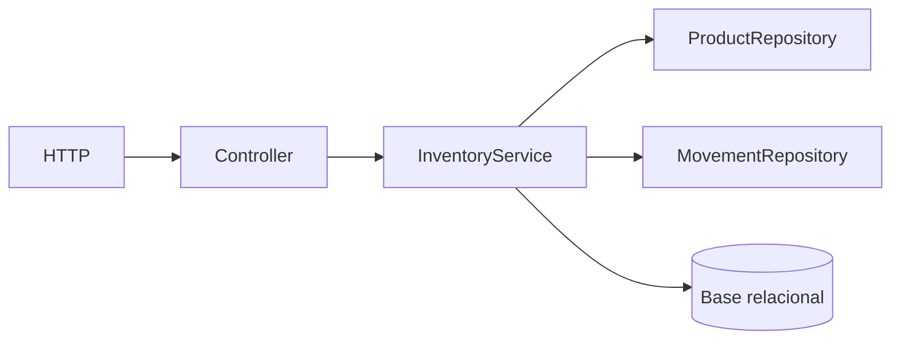

# Ejercicio 004 — Sistema de inventario aplicando SOLID

**Nivel:** Intermedio · **Tiempo estimado:** 12–16 horas

## Contexto y enunciado

Una pequeña tienda necesita controlar productos, existencias y movimientos de entrada y salida. Debe impedir salidas mayores al inventario actual y conservar un historial de movimientos.

## Objetivos y conocimientos previos

Practicar interfaces e inyección de dependencias donde haya variación real, servicios de dominio, transacciones y pruebas unitarias. Aplicar los cinco principios SOLID a decisiones concretas. Requiere JPA, excepciones y POO.

## Requisitos

### Funcionales

1. Crear y consultar productos.
2. Registrar entradas y salidas de existencias con cantidad positiva y motivo.
3. Consultar el stock actual y el historial de movimientos.
4. Rechazar una salida que deje stock negativo.
5. Guardar movimiento y stock de forma consistente.

### No funcionales y reglas propuestas

- Una operación aceptada actualiza inventario e historial en una única transacción.
- Una operación rechazada no debe dejar cambios parciales.
- Los tipos de movimiento son explícitos; cantidades son positivas y su dirección depende del tipo.
- La regla de no stock negativo debe verificarse también ante dos operaciones concurrentes.

## Casos de uso, entradas y salidas

Entrada de movimiento: `{"type":"OUT","quantity":3,"reason":"Venta"}`. Consultar stock devuelve producto y cantidad; registrar movimiento devuelve `201` con movimiento creado y cantidad resultante. Producto desconocido da `404`; cantidad inválida o stock insuficiente da `400` o un conflicto de dominio documentado.

Endpoints propuestos: `POST /api/products`, `GET /api/products/{id}`, `GET /api/products/{id}/movements`, `POST /api/products/{id}/movements`.

## Modelo y arquitectura

`Product(id, name, stock)` y `StockMovement(id, product, type, quantity, reason, createdAt)`. Relación uno a muchos de producto a movimientos. Controlador HTTP, servicio de aplicación para caso de uso, repositorios JPA para persistencia. No extraigas reglas a cinco clases distintas para que parezcan cumplir SOLID.



## Estructura y cuándo crear archivos

| Archivo/componente | Responsabilidad | Cuándo crearlo | Necesidad |
|---|---|---|---|
| `Product`, `StockMovement` | Estado persistente y relación | Al definir el dominio | Obligatorio |
| Repositorios JPA | Acceso a productos/movimientos | Al persistir | Obligatorio |
| `InventoryService` | Regla de stock y coordinación transaccional | Al implementar entrada/salida | Obligatorio |
| DTOs de solicitud/respuesta | Contrato HTTP | Al exponer API | Recomendado |
| `InventoryController` | Rutas y estado HTTP | Al exponer operaciones | Obligatorio |
| Interfaz `MovementPolicy` (ejemplo) | Variar política de movimiento solo si hay alternativas reales | Cuando una nueva regla o proveedor cambie de forma independiente | Posterior, no requisito automático |
| Excepción de dominio | Explicar una regla incumplida | Cuando el error no sea una entrada HTTP genérica | Útil |
| Pruebas del servicio | Reglas de negocio | Desde la primera regla | Obligatorio |

## Pasos y orientación

1. Implementa el caso de uso de entrada y el de salida con casos válidos e inválidos.
2. Asegura atomicidad y prueba que una salida rechazada no genera movimiento.
3. Señala decisiones SOLID: responsabilidad única en componentes, extensión de política si aparece una variación, sustitución segura de implementaciones cuando existan, interfaces pequeñas y dependencias dirigidas a abstracciones útiles.
4. **Pregunta:** ¿qué cambia junto y qué cambia por razones distintas?
5. **Orientación:** no crees abstracciones hasta que exista una razón observada.
6. **Pista:** una interfaz es útil aquí si permite sustituir una regla o límite externo sin alterar el caso de uso; una interfaz idéntica a una única clase puede no aportar nada.

## Pruebas y aceptación

Prueba stock inicial cero, entrada positiva, salida exacta, salida superior al stock, cantidades cero/negativas, producto ausente y fallo a mitad de transacción. Para concurrencia, explica el mecanismo elegido y añade una prueba que lo ejercite; un test secuencial no demuestra exclusión concurrente.

```powershell
curl.exe -i -X POST http://localhost:8080/api/products/1/movements -H "Content-Type: application/json" -d "{\"type\":\"OUT\",\"quantity\":3,\"reason\":\"Venta\"}"
curl.exe -i http://localhost:8080/api/products/1/movements
```

- El historial y el stock cambian juntos o no cambian.
- No hay stock negativo.
- Puedo trazar cada principio SOLID a una decisión real y señalar dónde sería sobreingeniería.
- **Errores comunes:** actualizar stock sin transacción; registrar una salida rechazada; crear interfaz para cada clase.
- **Extensiones:** reservar stock o manejar ubicaciones múltiples, si se justifican.
- [ ] Puedo explicar responsabilidad del controlador, servicio y repositorio. [ ] Puedo describir el caso de rollback.
- ¿Qué principio ayuda si la política de reposición cambia? ¿Cuál no necesitas aplicar todavía?

**Terminado cuando:** código compila, pruebas de reglas/atomicidad pasan y la explicación SOLID coincide con el diseño implementado.
