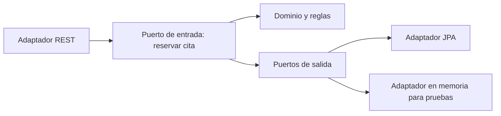

# Ejercicio 005 — Agenda de citas con arquitectura hexagonal

**Nivel:** Intermedio–avanzado · **Tiempo estimado:** 14–20 horas

## Contexto y enunciado

Una clínica quiere gestionar clientes, profesionales, horarios disponibles y citas. No se deben duplicar reservas de un mismo profesional en un horario ni reservar un horario que no esté disponible.

## Objetivos y conocimientos previos

Practicar entidades de dominio, casos de uso, puertos, adaptadores y pruebas que no dependan de Spring ni de una base real. Comparar la arquitectura hexagonal con capas convencionales y reconocer su costo. Requiere JPA, transacciones, pruebas y diseño OO.

## Requisitos

### Funcionales

1. Registrar clientes y profesionales.
2. Definir intervalos de disponibilidad.
3. Consultar espacios disponibles por profesional y fecha.
4. Reservar y cancelar una cita.
5. Rechazar solapamientos y reservas fuera de disponibilidad.

### No funcionales y reglas propuestas

- Un profesional no puede atender dos citas solapadas.
- Una cita requiere cliente, profesional, inicio, fin y estado.
- Inicio debe ser anterior a fin; las reglas de zona horaria deben quedar documentadas.
- Evitar revelar datos personales innecesarios en respuestas.

## Casos de uso y contrato

| Caso de uso | Entrada / salida | Errores |
|---|---|---|
| Consultar disponibilidad | profesional, fecha → intervalos libres | Profesional inexistente |
| Reservar cita | `{"customerId":4,"professionalId":2,"startsAt":"2026-11-02T10:00:00-05:00","endsAt":"2026-11-02T10:30:00-05:00"}` → `201` | `400` intervalo inválido; `404`; `409` conflicto |
| Cancelar | ID → estado cancelado | `404`; conflicto si estado no permite cancelar |

Endpoints sugeridos: `GET /api/professionals/{id}/availability?date=...`, `POST /api/appointments`, `DELETE /api/appointments/{id}`. La política de cambios de horario y cancelación es decisión de ejercicio que debe documentarse.

## Dominio y arquitectura

Dominio propuesto: `Appointment`, `TimeSlot`, `Customer`, `Professional`. Define un caso de uso de reserva y puertos de salida para cargar/guardar entidades y comprobar disponibilidad. El adaptador web traduce HTTP; el adaptador de persistencia implementa los puertos. Las reglas de solapamiento viven en dominio/aplicación, no en anotaciones HTTP.



## Paquetes y componentes

| Archivo/componente | Responsabilidad | Cuándo crearlo | Necesidad |
|---|---|---|---|
| `domain/Appointment` | Estado y reglas propias de cita | Al modelar reglas que no dependen de Spring | Obligatorio |
| `application/BookAppointment` | Coordinar caso de uso | Al separar flujo de negocio de adaptadores | Obligatorio |
| Puerto `AppointmentRepository` | Operaciones requeridas por el caso de uso | Cuando el caso necesita persistencia | Obligatorio en el diseño hexagonal |
| Puerto `AvailabilityPolicy` | Comprobar espacios libres | Cuando disponibilidad se define como dependencia del caso | Recomendado |
| Adaptador REST y DTOs | HTTP ↔ caso de uso | Al exponer API | Obligatorio |
| Adaptador JPA | Puerto ↔ base de datos | Al persistir | Obligatorio |
| Adaptador fake | Simular puertos | Al probar dominio/caso sin infraestructura | Obligatorio para demostrar independencia |
| `@Configuration` | Conectar puertos/adaptadores | Cuando la inyección necesite composición explícita | Solo si hace falta |

No añadas interfaz para cada entidad o método. Mantén el núcleo de dominio libre de anotaciones de infraestructura si ese aislamiento es un objetivo verificable.

## Pasos, pruebas y pistas

1. Escribe primero ejemplos de intervalos que se solapan y que no.
2. Implementa regla de dominio sin Spring; después conecta adaptador.
3. Distingue prueba de regla, prueba de caso de uso con fake y prueba de integración JPA.
4. Prueba límite exacto de inicio/fin, horarios adyacentes, citas canceladas y solicitudes concurrentes.
5. **Pregunta:** ¿qué debería poder probarse sin arrancar Spring?
6. **Orientación:** el caso de uso necesita una operación, no los detalles de SQL.
7. **Pista:** dos intervalos se solapan si el inicio de uno es anterior al fin del otro y viceversa; decide cómo tratar intervalos contiguos.

```powershell
curl.exe -i "http://localhost:8080/api/professionals/2/availability?date=2026-11-02"
curl.exe -i -X POST http://localhost:8080/api/appointments -H "Content-Type: application/json" -d "{\"customerId\":4,\"professionalId\":2,\"startsAt\":\"2026-11-02T10:00:00-05:00\",\"endsAt\":\"2026-11-02T10:30:00-05:00\"}"
```

## Aceptación, reflexión y terminado

- La regla de solapamiento tiene pruebas unitarias independientes de Spring.
- El caso de uso se prueba con adaptadores falsos; la integración verifica persistencia real.
- Una reserva duplicada devuelve conflicto y no crea una segunda cita.
- **Errores comunes:** poner todo en controladores; crear puertos sin consumidor; asumir que comprobar disponibilidad antes de guardar evita carreras.
- **Trade-off:** hexagonal facilita aislar dominio e intercambiar infraestructura, a cambio de más tipos y configuración. Una capa simple puede bastar para CRUD sin reglas.
- **Extensiones:** reglas de cancelación, zonas horarias y políticas de duración.
- [ ] Puedo dibujar la dirección de dependencias. [ ] Puedo señalar una ventaja y un costo concreto. [ ] Puedo explicar el riesgo de concurrencia.
- ¿Qué parte cambiaría si se sustituye JPA? ¿Qué parte debería permanecer igual?

**Terminado cuando:** compila, reglas y puertos tienen pruebas, integración JPA está comprobada y README documenta las decisiones reales.
