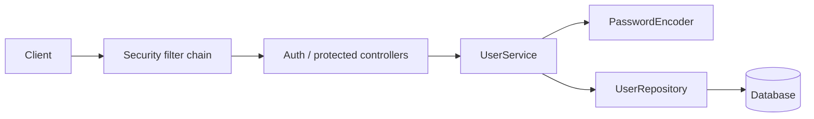

# Ejercicio 006 — Usuarios, autenticación y autorización

**Nivel:** Intermedio–avanzado · **Tiempo estimado:** 12–18 horas

## Contexto y enunciado

Una aplicación requiere cuentas de usuario y endpoints que solo puedan usar personas autenticadas o con un rol permitido. Implementa el flujo con usuarios ficticios y datos de prueba; no conectes proveedores reales.

## Objetivos y conocimientos previos

Aprender Spring Security, almacenamiento seguro de contraseñas, autenticación, autorización, configuración y pruebas de acceso. Requiere REST, DTO, validación, persistencia y excepciones.

## Requisitos

### Funcionales

1. Registrar usuario con nombre, email y contraseña.
2. Permitir autenticación mediante el mecanismo elegido y explicar el ciclo de credenciales.
3. Restringir rutas por autenticación y rol.
4. El usuario normal solo puede acceder a sus propios datos; el rol administrador puede consultar una vista administrativa definida.
5. Permitir pruebas reproducibles de acceso permitido y denegado.

### No funcionales y reglas

- Nunca guardar, registrar ni devolver contraseñas en texto plano.
- Usar el codificador de contraseñas de Spring Security; no diseñar criptografía propia.
- No incluir secretos reales en el repositorio; configurar valores locales mediante variables de entorno.
- No asumir que un token es seguro solo por estar firmado; documentar vencimiento y almacenamiento si se elige token.

## Casos de uso y endpoints propuestos

`POST /api/auth/register` recibe `{"email":"ana@example.test","password":"example-only","displayName":"Ana"}`; `POST /api/auth/login` inicia sesión según el mecanismo elegido; `GET /api/me` requiere autenticación; `GET /api/admin/users` requiere rol administrativo. Registro devuelve `201`, credenciales inválidas `401`, usuario autenticado sin permiso `403`, entrada inválida `400`.

La elección entre sesión y token es una decisión didáctica: empieza con la alternativa más sencilla que entiendas y justifica sus trade-offs. No uses tokens firmados construidos a mano.

## Modelo y arquitectura

`User(id, email, passwordHash, roles, displayName)`. El hash nunca forma parte del DTO de respuesta. Separar registro, autenticación y autorización; Spring Security aplica filtros y reglas, no sustituye las reglas de propiedad de recursos.



## Componentes y momento de creación

| Archivo/componente | Responsabilidad | Cuándo crearlo | Necesidad |
|---|---|---|---|
| `User` y rol | Cuenta persistente y permisos | Al modelar identidad | Obligatorio |
| `RegisterRequest`, `LoginRequest`, `UserResponse` | Contratos sin exponer hash | Antes de exponer endpoints | Obligatorio |
| `UserRepository` | Cargar y guardar cuentas | Al persistir | Obligatorio |
| `PasswordEncoder` | Hash/verificación de contraseña | Desde registro/autenticación | Obligatorio; implementación de Spring |
| `SecurityConfiguration` | Reglas de acceso y mecanismo | Al proteger la primera ruta | Obligatorio |
| Servicio de registro | Validación y creación segura | Al implementar alta | Obligatorio |
| Servicio de autenticación | Verificar identidad si el flujo lo requiere | Al implementar login | Según mecanismo elegido |
| Manejador de errores | Respuestas sin detalles sensibles | Al normalizar errores | Recomendado |
| Token service propio | Gestionar tokens | Solo si se elige token y no existe solución estándar adecuada | No crear por defecto |

## Pasos y pruebas

1. Protege una ruta sencilla; comprueba acceso anónimo frente a autenticado.
2. Añade registro con contraseña hasheada y luego autorización por rol.
3. Prueba dueño frente a otro usuario, rol normal frente a administrador, usuario duplicado y contraseña incorrecta.
4. **Pregunta:** ¿quién eres y qué puedes hacer son la misma pregunta?
5. **Orientación:** autenticación verifica identidad; autorización decide permisos.
6. **Pista:** `401` indica falta/fracaso de autenticación; `403`, identidad válida sin permiso.

```powershell
curl.exe -i -X POST http://localhost:8080/api/auth/register -H "Content-Type: application/json" -d "{\"email\":\"ana@example.test\",\"password\":\"example-only\",\"displayName\":\"Ana\"}"
curl.exe -i http://localhost:8080/api/me
curl.exe -i http://localhost:8080/api/admin/users
```

## Aceptación, reflexión y terminado

- El almacenamiento contiene hash, nunca contraseña original.
- Casos anónimo/autenticado, rol insuficiente y permiso correcto se verifican en pruebas.
- La respuesta pública y los logs no contienen hash, contraseña ni tokens.
- **Riesgos a investigar:** contraseñas débiles, enumeración de cuentas, exposición de secretos, acceso horizontal a datos ajenos, tokens expuestos y configuración permisiva.
- **Errores comunes:** codificar manualmente contraseñas; usar una misma regla `permitAll` para todo; confiar en que conocer un ID autoriza acceder al recurso.
- **Extensiones:** cambio de contraseña con comprobación de identidad; no añadir recuperación por email real.
- [ ] Explico autenticación vs autorización. [ ] Sé dónde se guarda el hash. [ ] Puedo explicar `401` vs `403`.
- ¿Cómo probarías que un usuario no puede leer el recurso de otro? ¿Qué dato jamás devolverías?

**Terminado cuando:** compila, pruebas de autorización pasan y no hay credenciales ni secretos en el repositorio.
