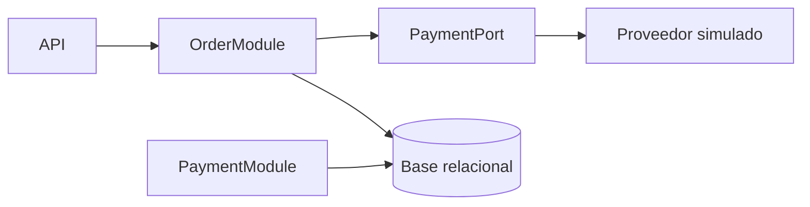

# Ejercicio 007 — Pedidos y pagos simulados

**Nivel:** Avanzado inicial · **Tiempo estimado:** 14–20 horas

## Contexto y enunciado

Una tienda necesita crear pedidos de productos, calcular totales, gestionar estados y procesar pagos mediante un proveedor simulado que puede aprobar, rechazar o no responder.

## Objetivos y conocimientos previos

Practicar reglas de negocio, transacciones, idempotencia y manejo de fallos de integración en un monolito modular. Requiere POO, colecciones, JPA, validación, pruebas y nociones de seguridad.

## Requisitos

### Funcionales

1. Crear pedido con líneas y cantidades válidas.
2. Calcular total a partir de precios actuales documentando si el precio queda congelado en la línea.
3. Solicitar un pago a un proveedor falso; registrar aprobado o rechazado.
4. Transicionar el pedido siguiendo estados definidos.
5. Evitar cargos duplicados cuando se repite una solicitud con la misma clave de idempotencia.

### No funcionales y reglas propuestas

- No procesar dinero real ni contactar proveedores reales.
- Importe usa `BigDecimal`; las cantidades deben ser positivas.
- Una solicitud repetida con la misma clave y el mismo contenido devuelve el resultado previo; misma clave con contenido distinto se rechaza.
- Fallo/timeout del proveedor no debe confundirse con pago rechazado.

## Casos de uso y contrato sugerido

`POST /api/orders` con `{"items":[{"productId":3,"quantity":2}]}` crea pedido `PENDING_PAYMENT`. `POST /api/orders/{id}/payments` con `Idempotency-Key: demo-123` simula pago; respuestas propuestas: `201` pedido, `200` pago aprobado, `402` rechazo simulado o `503` proveedor no disponible (elige y documenta convención). Consultar: `GET /api/orders/{id}`.

## Modelo y arquitectura

Módulos `orders`, `payments`, `catalog` dentro de un solo proceso. `Order`, `OrderLine`, `PaymentAttempt`; proveedor de pago detrás de interfaz porque es una frontera externa intercambiable. El módulo de pedidos no debe depender de la implementación de infraestructura del proveedor.



Monolito modular mantiene un despliegue y transacciones más sencillas mientras delimita responsabilidades. Microservicios añadirían red, despliegue y consistencia distribuida sin necesidad para este ejercicio.

## Componentes

| Archivo/componente | Responsabilidad | Cuándo crearlo | Necesidad |
|---|---|---|---|
| `Order`, `OrderLine`, estados | Pedido y ciclo de vida | Al definir reglas | Obligatorio |
| `PaymentAttempt` | Resultado y referencia de intento simulado | Al registrar pagos | Obligatorio |
| `PlaceOrder`, `PayOrder` | Casos de uso | Cuando exista flujo independiente de HTTP | Recomendado |
| Puerto `PaymentProvider` | Contrato de integración | Para separar módulo de proveedor externo | Obligatorio |
| `FakePaymentProvider` | Aprobar/rechazar/fallar de forma predecible | Durante práctica | Obligatorio |
| `IdempotencyRecord` | Asociar clave con operación y resultado | Antes de aceptar reintentos seguros | Obligatorio |
| Repositorios y controladores | Persistencia y API | Al añadir infraestructura | Obligatorio |
| `@Configuration` | Elegir adaptador simulado | Al conectar dependencias | Si la configuración lo requiere |

## Pasos, pruebas y pistas

1. Define primero la máquina de estados permitida y transiciones prohibidas.
2. Implementa el proveedor falso con resultados elegibles en pruebas.
3. Añade almacenamiento transaccional para clave y resultado; prueba repetir solicitud antes de integrar reintentos.
4. **Pregunta:** ¿qué parte puede repetirse sin repetir el efecto?
5. **Orientación:** distingue operación de pago, intento y resultado.
6. **Pista:** persistir la clave y el efecto en límites transaccionales correctos es más importante que solo comprobar si la clave existe antes de actuar.

Prueba total, producto/precio inexistente, cantidad inválida, pago aprobado, rechazo, timeout, repetición idéntica, clave reutilizada con otro cuerpo y estados no permitidos. Comprueba efectos persistidos tras fallo.

```powershell
curl.exe -i -X POST http://localhost:8080/api/orders -H "Content-Type: application/json" -d "{\"items\":[{\"productId\":3,\"quantity\":2}]}"
curl.exe -i -X POST http://localhost:8080/api/orders/1/payments -H "Idempotency-Key: demo-123"
```

## Aceptación y reflexión

- No hay integración con pagos reales.
- Transiciones válidas e inválidas tienen pruebas.
- Solicitud repetida con clave idéntica no crea segundo efecto de pago.
- El resultado del proveedor simulado no se presenta como transferencia real.
- **Errores comunes:** calcular total desde precio enviado por cliente; repetir cargo por retry; tratar timeout como rechazo confirmado.
- **Extensiones:** reembolso simulado, expiración de idempotencia o outbox como avance.
- [ ] Puedo explicar la frontera del proveedor. [ ] Puedo enumerar estados y transiciones. [ ] Puedo argumentar por qué sigue siendo un monolito.
- ¿Qué pasa si el proveedor responde tarde? ¿Qué estado queda si se pierde la respuesta después del éxito?

**Terminado cuando:** compila, pruebas de estado/idempotencia/fallo pasan y la solución permanece como monolito modular documentado.
