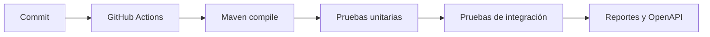

# Ejercicio 008 — Calidad profesional y automatización

**Nivel:** Avanzado inicial · **Tiempo estimado:** 10–16 horas

## Contexto y enunciado

El equipo necesita poder cambiar una aplicación anterior con confianza y comprobar automáticamente que compila, que sus comportamientos principales siguen funcionando y que la documentación de la API está disponible.

## Objetivos y conocimientos previos

Aplicar JUnit, Mockito con moderación, pruebas de integración, cobertura, OpenAPI y GitHub Actions. Elige el ejercicio 003, 004 o 005 como base; comprende ya sus reglas y arquitectura.

## Alcance y requisitos

1. Identificar flujos críticos y riesgos antes de añadir pruebas.
2. Añadir pruebas unitarias para reglas y pruebas de integración para límites HTTP/persistencia.
3. Medir cobertura como señal, no como objetivo aislado.
4. Documentar contrato API con OpenAPI y describir cómo ejecutarlo.
5. Crear flujo CI que compile y ejecute pruebas en push y pull request.

No se exige una cifra mínima universal de cobertura. Como objetivo didáctico se puede medir cobertura de reglas de dominio, justificar exclusiones y comprobar ramas importantes sin cambiar código productivo solo para inflar el porcentaje.

## Casos de uso

| Caso | Resultado que se debe comprobar |
|---|---|
| Ejecutar build y pruebas | El proyecto compila y los tests pasan |
| Enviar un cambio a CI | El workflow reproduce la verificación local y marca el resultado |
| Consultar documentación API | La especificación refleja los endpoints existentes |
| Provocar un fallo de regla | Una prueba falla por el comportamiento incorrecto, no por detalles internos |

## Diseño y flujo



### Componentes y archivos

| Archivo/componente | Responsabilidad | Cuándo crearlo | Necesidad |
|---|---|---|---|
| Pruebas unitarias | Reglas sin infraestructura innecesaria | Desde el inicio de la auditoría | Obligatorio |
| Pruebas de integración | Contratos Spring/HTTP/JPA | Para límites que la prueba unitaria no cubre | Obligatorio |
| Fixtures/builders de prueba | Reutilizar preparación repetida y legible | Si hay repetición real | Posterior |
| Dependencia OpenAPI | Generar contrato legible | Al documentar endpoints | Recomendado |
| Archivo de configuración OpenAPI | Metadatos del API | Si los valores por defecto no bastan | Posterior |
| `.github/workflows/ci.yml` | Automatización de build/test | Al validar cambios en GitHub | Obligatorio |
| Plugin de cobertura | Reportar cobertura útil | Al investigar ramas no probadas | Recomendado |

## Pasos, pruebas y orientación

1. Escribe una lista de comportamientos críticos antes de tocar pruebas.
2. Clasifica cada prueba como unidad, integración o contrato y justifica su costo.
3. Implementa CI con JDK 17 y Maven Wrapper.
4. Valida localmente con `.\mvnw.cmd clean verify`.
5. **Pregunta:** ¿qué fallo detectaría este test que no detectaría el test vecino?
6. **Orientación:** prefiere aserciones sobre resultado observable a verificar cada llamada interna.
7. **Pista:** usa mocks para límites externos o dependencias difíciles, no para simular todo el sistema.

Casos límite: errores de validación, `404`, reglas principales, transacción/persistencia, comportamiento del proveedor falso y ejecución limpia sin estado local previo.

```powershell
.\mvnw.cmd clean verify
```

Inspecciona la especificación OpenAPI de la aplicación por el mecanismo que la dependencia instalada documente. No presupongas una URL hasta confirmar la configuración.

## Aceptación, errores y terminado

- CI usa Java 17 y reporta un fallo si build o pruebas fallan.
- Hay pruebas de reglas críticas y al menos una integración por límite importante.
- La documentación refleja rutas, parámetros, códigos y ejemplos reales.
- El porcentaje de cobertura se informa con contexto y no sustituye revisión de casos.
- **Errores comunes:** probar solo getters; verificar interacción sin resultado observable; bajar aserciones para “hacer pasar” CI; usar mocks para cada clase.
- **Extensiones:** análisis estático compatible, caché Maven en CI, matriz de JDK como estudio opcional.
- [ ] Puedo explicar por qué cada prueba está en su nivel. [ ] Puedo leer un fallo de CI. [ ] Puedo identificar conducta no cubierta.
- ¿Qué comportamiento importante tiene pocas pruebas? ¿Cuál sería un test frágil y por qué?

**Terminado cuando:** `clean verify` pasa localmente, workflow pasa en GitHub y no se alteró código de producción únicamente para elevar cobertura.
