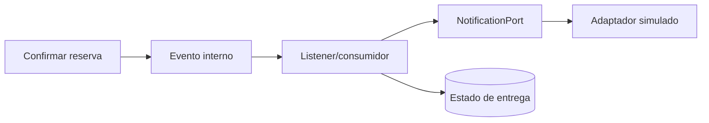

# Ejercicio 009 — Notificaciones orientadas a eventos

**Nivel:** Avanzado · **Tiempo estimado:** 14–20 horas

## Contexto y enunciado

Cuando se confirma una reserva o un pedido, la aplicación debe preparar una notificación. El flujo principal no debería quedar acoplado al mecanismo que finalmente la entrega.

## Objetivos y conocimientos previos

Comenzar con eventos internos de Spring y procesadores simulados; después estudiar RabbitMQ o Kafka como ampliación opcional. Aprender productores, consumidores, asincronía, reintentos, idempotencia, fallos y consistencia eventual. Requiere un flujo del ejercicio 005 o 007, transacciones y pruebas.

## Requisitos

### Funcionales

1. Publicar evento cuando se confirma una reserva/pedido.
2. Consumirlo con un adaptador de notificación simulado.
3. Registrar resultado de entrega simulada y permitir consultar estado.
4. Evitar procesar dos veces el mismo evento.
5. Representar fallo temporal y política limitada de reintentos.

### No funcionales y reglas

- Empieza con eventos internos, no con broker externo.
- No enviar emails/SMS reales ni guardar datos personales innecesarios.
- Define si el evento se publica antes o después de confirmar la transacción.
- Una notificación fallida no debe cambiar silenciosamente un pedido confirmado.

## Casos de uso, entradas y salidas

El caso principal confirma una reserva con `POST /api/appointments`; respuesta de negocio `201`. La emisión y consumo son asíncronos, por lo que el envío no se garantiza antes de responder. Una ruta didáctica opcional `GET /api/notifications/{eventId}` devuelve estado `PENDING`, `SENT` o `FAILED`. Eventos son datos internos, no un endpoint de publicación pública.

Evento propuesto: `AppointmentConfirmed(eventId, appointmentId, occurredAt)`. No incluir email/teléfono si se puede resolver al momento de notificar; documenta el trade-off.

## Arquitectura y modelo

Un evento interno Spring circula dentro de la aplicación; un broker ofrece comunicación duradera entre procesos; microservicios implican límites de despliegue y operación. No son conceptos equivalentes.

| Archivo/componente | Responsabilidad | Cuándo crearlo | Necesidad |
|---|---|---|---|
| `AppointmentConfirmed` | Datos inmutables del hecho ocurrido | Al definir contrato del evento | Obligatorio |
| Productor de evento | Publicar tras caso de uso | Al conectar flujo fuente | Obligatorio |
| Listener | Atender evento | Al procesar notificación | Obligatorio |
| `NotificationPort` | Separar canal real/falso | Cuando exista adaptador intercambiable | Útil |
| Adaptador de notificación fake | Simular éxito/fallo | Durante aprendizaje | Obligatorio |
| `NotificationDelivery` | Estado y deduplicación | Al necesitar consulta/reintentos | Obligatorio |
| Outbox | Persistir evento en misma transacción de origen | Si se busca confiabilidad entre DB y broker | Ampliación, no para primer evento interno |
| Configuración RabbitMQ/Kafka | Integración broker | Solo en ampliación y cuando el evento interno esté probado | Opcional |

## Pasos y pruebas

1. Crea evento interno y consumidor fake; verifica que el flujo genera evento correcto.
2. Introduce fallo transitorio y política con límite de intentos.
3. Simula evento duplicado y consumidor reiniciado.
4. **Pregunta:** ¿qué ocurre si se confirma la reserva y falla el envío?
5. **Orientación:** evento representa un hecho confirmado, no una instrucción para mutar el pasado.
6. **Pista:** los consumidores deben tolerar duplicados; “exactly once” no se obtiene solo con un listener.

Prueba éxito, fallo permanente/temporal, duplicados, evento previo a rollback, orden de eventos y estado eventualmente actualizado. Confirma cómo espera la prueba al consumidor asíncrono sin depender de pausas arbitrarias.

## Aceptación y reflexión

- El flujo principal no depende directamente del canal de notificación.
- Eventos duplicados no generan dos entregas simuladas.
- Fallos y reintentos quedan observables y acotados.
- **Errores comunes:** asumir ejecución síncrona; publicar antes de confirmar datos; añadir broker antes de tener necesidad; confundir evento de dominio con comando.
- **Extensiones:** reemplazar el fake con RabbitMQ o Kafka y documentar instalación, entrega, reintentos y persistencia; añadir una outbox transaccional si se necesita garantizar publicación tras guardar el estado.
- [ ] Distingo evento interno, mensajería y microservicio. [ ] Puedo explicar consistencia eventual. [ ] Puedo explicar qué garantiza el outbox.
- ¿Qué puede ver el usuario mientras la notificación está pendiente? ¿Qué hace seguro reprocesar el evento?

**Terminado cuando:** aplicación y pruebas verifican generación, procesamiento y fallo simulado; un broker externo sigue siendo opcional.
