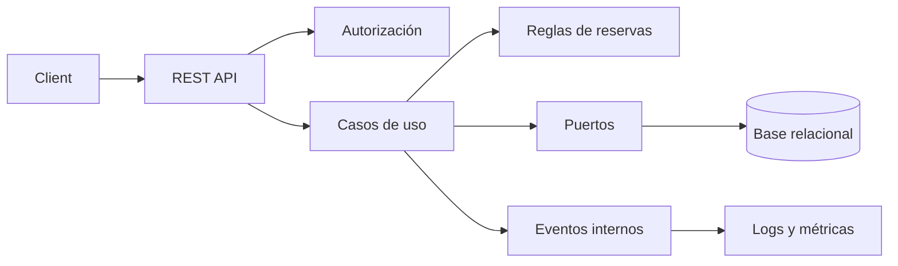

# Ejercicio 010 — Plataforma completa de reservas

**Nivel:** Integrador avanzado · **Tiempo estimado:** 25–40 horas

## Contexto y enunciado

Un cliente solicita una plataforma para que usuarios reserven servicios ofrecidos por proveedores que administran recursos y agendas. El sistema debe soportar reservas, cancelaciones, historial y reportes sin aceptar duplicados aunque lleguen solicitudes simultáneas.

## Objetivos y conocimientos previos

Integrar Java, Spring Boot, API REST, validación, persistencia, transacciones, seguridad, pruebas, observabilidad y documentación. Comparar monolito modular con arquitectura hexagonal y escoger con argumentos. Requiere los ejercicios anteriores; no se espera resolverlo antes.

## Requisitos

### Funcionales propuestos

1. Registrar usuarios, proveedores, servicios y recursos.
2. Administrar agendas y horarios disponibles.
3. Consultar disponibilidad, crear y cancelar reservas.
4. Mantener historial de cambios y reportes básicos.
5. Proteger operaciones de gestión y limitar datos privados.

### No funcionales y reglas por decidir explícitamente

- Dos reservas confirmadas no pueden ocupar el mismo recurso y periodo.
- La regla debe sostenerse con solicitudes concurrentes, no solo una comprobación previa en Java.
- Cada recurso define zona horaria, duración/intervalos y política de cancelación.
- Acciones sensibles deben dejar registro útil; nunca registrar contraseñas o secretos.
- Elegir objetivos medibles para disponibilidad, latencia y retención solo si se van a probar.

## Casos de uso, entradas y errores

Flujo principal: buscar disponibilidad para servicio/proveedor/fecha; crear reserva; consultar; cancelar según política; consultar historial. Ejemplo de alta: `{"serviceId":7,"resourceId":3,"startsAt":"2026-12-10T14:00:00-05:00","endsAt":"2026-12-10T14:30:00-05:00"}`.

Endpoints sugeridos: `GET /api/availability`, `POST /api/reservations`, `GET /api/reservations/{id}`, `POST /api/reservations/{id}/cancellation`, `GET /api/users/me/reservations`. Respuestas: `201` creada, `200` consulta, `400` inválida, `401/403` acceso, `404` ausente, `409` recurso ocupado o conflicto concurrente.

## Modelo y arquitectura

Entidades candidatas: `User`, `Provider`, `Service`, `Resource`, `Availability`, `Reservation`, `ReservationHistory`. Define cardinalidades, estados y propiedad de datos antes de implementar; no es obligatorio conservar todas como entidades independientes si el diseño demuestra lo contrario.



Empieza con monolito modular: usuarios, catálogo, agenda, reservas e informes en un despliegue. Adopta arquitectura hexagonal en los límites donde probar o intercambiar adaptadores sea valioso. Microservicios no son requisito; elevarían costo de transacciones y operación.

## Archivos y organización propuesta

| Archivo/componente | Responsabilidad | Cuándo crearlo | Necesidad |
|---|---|---|---|
| Modelo de dominio y estados | Expresar reglas y transiciones | Tras acordar casos de uso | Obligatorio |
| DTOs por operación | Contratos de entrada/salida | Al exponer cada API | Obligatorio |
| Controladores por módulo | HTTP y autorización declarativa | Al crear endpoints | Obligatorio |
| Servicios/casos de uso | Coordinar reglas y persistencia | Al implementar flujos | Obligatorio |
| Repositorios | Consulta y persistencia | Al fijar almacenamiento | Obligatorio |
| Restricción transaccional/índice de exclusión | Evitar doble reserva a nivel persistente | Al implementar concurrencia | Obligatorio; elegir según base |
| `SecurityConfiguration` | Roles y límites de acceso | Al exponer rutas restringidas | Obligatorio |
| Eventos internos | Desacoplar trabajo posterior | Cuando haya consumidor asíncrono real | Posterior |
| `@Configuration` e integración | Conectar adaptadores | Al necesitar composición/configuración | Según diseño |
| ADRs | Registrar decisión y trade-off | Cuando decisión arquitectónica tenga impacto duradero | Obligatorio por consigna |
| Docker/CI | Ejecutar y verificar aplicación repetiblemente | Tras build y pruebas locales estables | Obligatorio al cerrar |

## Etapas de implementación y pistas

1. **Comprender:** dibuja usuario, proveedor, servicio, recurso y reserva.
2. **Requisitos:** define propiedad, cancelación, zonas horarias y conflicto.
3. **Diseño:** compara capa simple, modular y hexagonal; registra una ADR con contexto, decisión y consecuencias.
4. **Base mínima:** crea un proyecto y un flujo de reserva vertical.
5. **Implementar:** agrega disponibilidad, autenticación/autorización y cancelación en pequeños cambios.
6. **Probar:** incluye el caso concurrente con la base elegida.
7. **Refactorizar:** extrae módulos o puertos solo al encontrar acoplamiento o test difícil.
8. **Documentar:** API, ejecución, variables, observabilidad y límites conocidos.

**Pistas progresivas:** (1) ¿qué significa “duplicada” para recursos y periodos? (2) la consulta previa ayuda al mensaje, pero no protege de dos transacciones concurrentes; (3) busca una restricción o mecanismo atómico en la base de datos y prueba dos solicitudes simultáneas.

## Pruebas y solicitudes

Pruebas unitarias de intervalos y estados; integración de persistencia y seguridad; prueba concurrente con dos solicitudes que compiten por el mismo recurso; prueba de permisos por rol/propiedad; prueba de cancelación y zonas horarias. Evita afirmar consistencia concurrente basándote únicamente en tests secuenciales.

```powershell
curl.exe -i "http://localhost:8080/api/availability?serviceId=7&date=2026-12-10"
curl.exe -i -X POST http://localhost:8080/api/reservations -H "Content-Type: application/json" -d "{\"serviceId\":7,\"resourceId\":3,\"startsAt\":\"2026-12-10T14:00:00-05:00\",\"endsAt\":\"2026-12-10T14:30:00-05:00\"}"
```

## Criterios de aceptación y terminado

- Cada flujo documentado tiene pruebas adecuadas a su nivel.
- La aplicación no permite doble reserva, incluso bajo competencia, y el mecanismo está demostrado.
- Las reglas de autorización impiden acceso a reservas ajenas.
- API documentada; CI compila y ejecuta pruebas; Docker es reproducible si se incluye.
- Las ADR explican alternativas, costos y consecuencias.
- **Errores comunes:** modelar todas las entidades de una vez; considerar suficiente una consulta de disponibilidad; añadir microservicios/broker antes de demostrar necesidad; ignorar zonas horarias.
- **Extensiones:** notificaciones con eventos, auditoría avanzada y métricas de negocio, solo después del flujo base.
- [ ] Puedo justificar módulos y persistencia. [ ] Puedo explicar protección ante concurrencia. [ ] Puedo explicar trade-offs de arquitectura.
- ¿Qué parte tiene que ser transaccional? ¿Qué consistencia se sacrifica si una notificación es asíncrona? ¿Qué evidencia respalda cada ADR?

**Terminado cuando:** build y pruebas relevantes pasan, se demuestra concurrencia y autorización, API/documentación están actualizadas y se registran decisiones de arquitectura. Este README define el objetivo; no significa que la aplicación ya exista.
